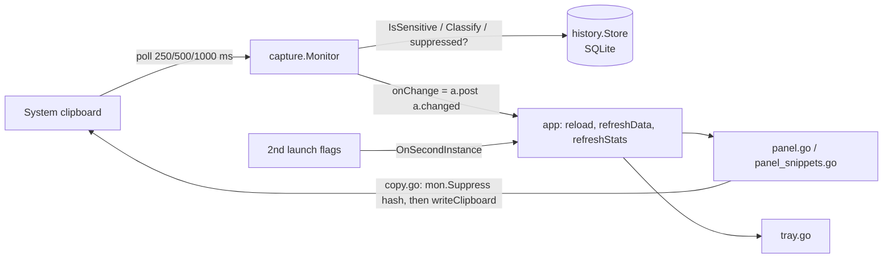

# Repository Guidelines

## Project Overview

Okiba Clip (slug `okibaclip`) is a clipboard history manager for macOS 12+, Windows 10/11 and Linux (GTK 3), built on [mygo](https://github.com/egoist/mygo) (pinned at v0.7.4) with its native immediate-mode `ui` package. It runs in the tray or menu bar with no Dock icon. It records text, rich text, links, colors, images and files, and opens a searchable panel from a global shortcut (default `Alt+Shift+V`). The panel also has snippets, text transforms and export/import.

Product constraints to keep:
- No keystroke injection and no Accessibility permission. Choosing an entry copies it and hides the panel; the user pastes.
- Copies that password managers mark as concealed or transient are skipped (`internal/capture/classify.go`).
- Every data file is mode 0600: the history DB, `settings.json` and exports.

## Architecture & Data Flow



- **`main.go`:**
  - Sets the app name, takes the single-instance lock, points `PathUserData` at the `okibaclip` folder and runs `configureLinuxBackend` (Wayland/XWayland), then runs the app.
  - `app.ready()` (`app.go`) opens `settings.json` and `history.db` from `mygo.App.Path(mygo.PathUserData)`, then builds the panel, tray and shortcut.
- **`app` struct (`app.go`):** the single owner of state. View state (`items`, `query`, `tab`, `selected`, `list`, `gen`/`previewGen`…) is touched only on the main thread.
- **Monitor (`internal/capture/monitor.go`):** polls the clipboard. It uses a change token on macOS and Windows (`token_*.go`, build-tagged) and a content fingerprint elsewhere. Captures upsert by content hash (`history.Capture.Hash`), then `Prune` runs.
- **Search (`internal/search`, `history.List`):**
  - `app.reload` runs `search.Parse(a.query, time.Now())`. The result has terms (words and `"phrases"`) and filters (`type:`, `is:`, `after:`, `before:`). The query the current results answer is kept in `a.shown`; highlights and the result count read from it.
  - `history.List` prefilters in SQL: tab and filters, `instr(search, term)` for substrings, and `substr(search,1,512) LIKE '%t%e%r%m%'` for fuzzy candidates. It then ranks in Go with `search.Score`. List rows hold only the first 4000 characters of the text, so each term also returns a whole-text `instr` flag. Keep both parts in step when changing matching.
  - The UI highlights matches with `search.Highlight` (byte ranges), rendered as `ui.RichText` spans in `app.highlighted`.
  - The search field takes Enter, so `OnTextKey` copies the chosen row on ↵ / ⇧↵ (plain).
- **Copy-back (`copy.go`):**
  - `a.write(hash, d)` calls `mon.Suppress(hash)` *before* `a.writeClipboard` so the next poll can't record the app's own write, and `mon.Unsuppress`es it if the write fails. A suppression drops one matching capture within 3 s; several can be pending. Keep this order.
  - Text writes hash with `textHash(text)`; file writes with `filesHash(paths actually written)`.
  - When `MoveToTopOnCopy` is on, `copyEntry` doesn't suppress on purpose; it `Touch`es the entry after a successful write instead.
- **CLI (`app.command`):** a second launch forwards `--toggle|--show|--hide|--settings|--pause|--resume|--quit` to the running instance. A bare launch shows the panel.
- **Export/import (`exportimport.go`, `internal/history/export.go`):**
  - Writes format `okibaclip-export`, version 1.
  - Imports are capped at 512 MiB (`MaxImportSize`).

## Key Directories

| Path | Purpose |
|---|---|
| `/` (package `main`) | App wiring and all UI: `app.go`, `panel*.go`, `settings_view.go`, `tray*.go`, `copy.go`, `format.go`, `icons.go` (Lucide icons), `platform.go` |
| `internal/capture/` | Clipboard polling, classification, sensitivity checks, per-OS change tokens |
| `internal/history/` | SQLite store (`store.go`), entries/thumbnails (`entry.go`), snippets, export format |
| `internal/history/historytest/` | Test fixtures: `T0`, `NewStore(t)`, `Add`, `PNG`, `Texts` |
| `internal/settings/` | `settings.json` model, `Normalize` clamping, atomic 0600 `Save` |
| `internal/search/` | Query parsing, word scoring (whole word > word start > substring > fuzzy), highlight ranges |
| `internal/transform/` | Text transforms offered in the context menu |
| `resources/` | `icon.png`; ships with every build (platform subdirectories like `resources/linux-amd64/` ship only with that platform) |
| `.agents/skills/mygo-maintenance/` | mygo UI/threading rules; read before UI work |
| `build/` | Git-ignored build output; may hold stale binaries |

## Development Commands

```sh
go run .                    # run unpackaged (or: go tool mygo dev)
go tool mygo vet .          # go vet ./... plus mygo's UI-lifetime/goroutine-capture checks
CGO_ENABLED=0 go test ./... # what CI runs on ubuntu, macOS and Windows
go tool mygo build          # installers/packages into build/<goos>-<goarch>/
go tool mygo build -platform linux/amd64,windows/amd64,darwin/arm64 -skip-installer   # CI cross-build
go tool mygo doctor         # check the local toolchain/environment
```

Format with `gofmt`. There is no other linter.

## Code Conventions & Common Patterns

- **Threading:**
  - The UI and all `app` view state live on the main thread.
  - Run slow work with `a.async(func(){…})`, then hand results back with `a.post(fn)` (`panel.Update`, which is asynchronous).
  - Reject stale results by bumping and comparing `a.gen` / `a.previewGen`.
  - Never capture `*ui.Context` or UI elements in goroutines.
- **Test seams (dependency injection):**
  - `async`, `post` and `writeClipboard` are `app` fields.
  - `mon` is the `captureControl` interface.
  - `src` is a `capture.Source`.
  - Add new side effects behind a seam like these, not as direct globals.
- **UI (mygo `ui`):**
  - Store data, `ui.Handle`, `ui.ListState` and `ui.Selection`, never elements.
  - Give stateful widgets stable identity, e.g. `ui.List(c.Key("history"), &a.list, n).ItemKey(func(i int) any { return a.items[i].ID })`.
  - Bind focus targets with `.Bind(&a.search)`.
  - Work that would mutate a collection while it's being built goes into `a.pending` and runs after the list is built.
  - Full rules: `.agents/skills/mygo-maintenance/SKILL.md`.
- **Errors:**
  - Startup failures call `mygo.Dialog.Error(appName, …)`, then `mygo.App.Quit()`.
  - User actions report through toasts (`a.toast`, with an undo list in `toastUndo`), or through `copyResult{ok, toast, err}` for copies.
  - Background problems are logged with `slog.Warn` / `slog.Error`.
- **Settings:** always pass settings through `settings.Normalize`, which clamps entries, retention, image size and poll interval. Persist with `settings.Save`, which writes a temp file and renames it with mode 0600.
- **Platform code:**
  - Prefer build-tagged files (`token_darwin.go`, `token_windows.go`, `token_other.go`).
  - For small differences, use runtime checks (`isDarwin`, `a.waylandMode`).
  - The env var `OKIBACLIP_NATIVE_WAYLAND=1` disables the forced XWayland.
- **Identity:**
  - `appName` ("Okiba Clip", `main.go`) is the display name: menus, dialogs, tray, login items and the single-instance key. Use the constant in UI strings.
  - `dataDirName` (`okibaclip`) names the data folder. `mygo.json` sets the display `name`, the ASCII `slug` (executable, packages, installers) and the identifier `io.github.zulmuzakir.okibaclip`, which sets the macOS bundle ID, login-item keys and the Windows uninstall key.
  - Changing the data folder or identifier after a release strands user data or settings tied to the old value, so it then needs a migration in `main.go`.
- **Naming:** unexported, short, lowerCamel helpers (`refreshData`, `copyEntry`, `applyShortcut`). Tests are named after the behavior, e.g. `TestPanel<Behavior>`, `TestMonitor<Behavior>`, `TestPruneKeepsPinnedAndRespectsMaxAndRetention`.

## Important Files

- `main.go`: entry point, single-instance lock, Linux backend selection.
- `app.go`: the `app` struct, `ready()`, `command()` (CLI flags), shortcut handling, `captureControl`.
- `panel.go`, `panel_snippets.go`: panel UI (search, tabs, list, preview, context menu, snippet editor).
- `copy.go`: clipboard write-back and suppression.
- `internal/capture/monitor.go`, `classify.go`: the capture pipeline.
- `internal/history/store.go`: schema, `Capture` upsert, `Prune`, search.
- `go.mod`: Go 1.27.3; `tool github.com/egoist/mygo/cmd/mygo` (this is what enables `go tool mygo`).
- `mygo.json`: name, identifier, version (bump it to match release tags; tags don't set artifact versions), `LSUIElement`, Linux deb deps (`libayatana-appindicator3-1`, `webview: false`).
- `.github/workflows/ci.yml`, `release.yml`: CI and tag-driven (`v*`) draft releases.

## Runtime/Tooling Preferences

- Use the Go toolchain plus `go tool mygo`; never install mygo globally. Check APIs against the pinned source: `go list -m -f '{{.Dir}}' github.com/egoist/mygo`.
- **No cgo:**
  - SQLite (`mygo/plugins/sqlite`) is loaded at run time through purego.
  - The first unpackaged run or test downloads a checksummed library into the user cache. `MYGO_SQLITE_LIBRARY` overrides the path.
- **Linux runtime:** GTK 3 and `libayatana-appindicator3-1` (tray). Without the appindicator library the app runs and shows the panel at launch.
- **Build hosts:**
  - Windows installers need `makensis`.
  - DMGs and code signing need macOS. Other hosts skip them with a warning.

## Testing & QA

- **Framework:** stdlib `testing` only, often table-driven; there is no testify or mock library. Store tests use the external `history_test` package with `historytest` fixtures.
- **UI tests (`panel_test.go`):**
  - `newPanelFixture` makes `async`/`post` synchronous, records `writeClipboard` calls and uses a `fakeMon`.
  - It drives `ui.NewTester(a.view, 720, 480)` with `Frame`, `Key`, `Type`, `Click`, `RightClick` and `ChooseMenuItem`, and asserts with `HasText` / `Texts` and the recorded writes.
- **Monitor tests:** use a `fakeClip`, inject `m.now` and call `m.tick(ctx)` directly. Never sleep.
- **Determinism:** fixed times (`historytest.T0`), `t.TempDir()` for databases and files, no network apart from the one-time SQLite download.
- **Before you finish:** run `go tool mygo vet .` and `CGO_ENABLED=0 go test ./...`. Add `go test -race ./...` when you change shared state; CI doesn't run it.
- **Coverage gaps:**
  - No tests for tray, settings view, export/import wiring or `capture/source.go`.
  - For UI or platform changes, also run the app (`go run .`) and check the real surface.
